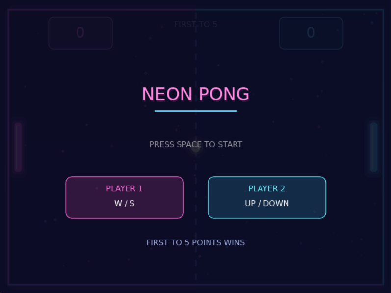
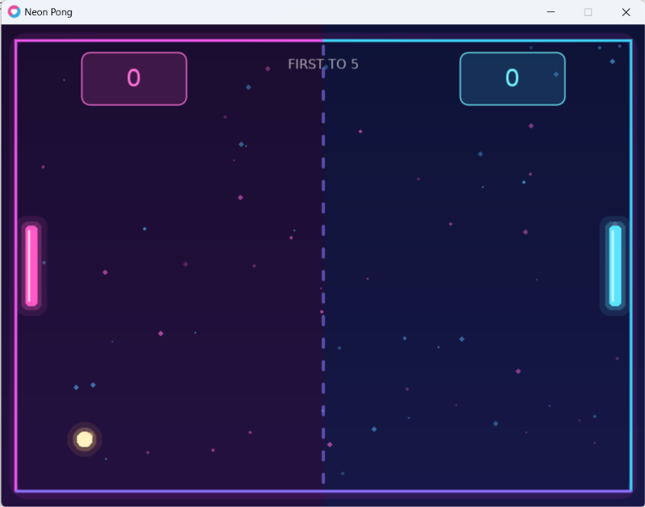
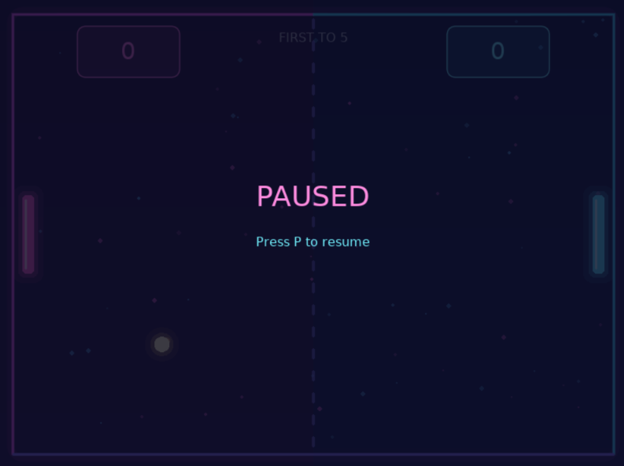
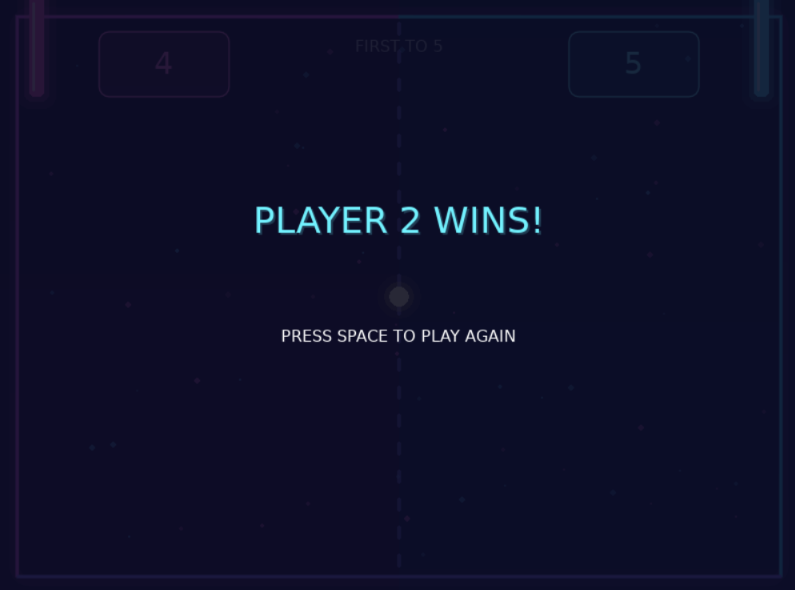

# Neon Pong Game 🎮

A two-player Pong game built using **Lua** and **LÖVE2D** for the Artificial Intelligence and Games course.

## Student Information

- **Name:** Rajaa Moneer Ahmad Ibrahim
- **Student ID:** 12220345
- **Course:** Artificial Intelligence and Games

## About the Game

Neon Pong is a two-player arcade game where players control paddles to keep the ball from passing their side. The ball bounces off walls and paddles, and players earn points when their opponent misses. The first player to reach 5 points wins.

## How to Run

1. Install [LÖVE2D](https://love2d.org/).
2. Download or clone this repository.
3. Open a terminal in the project folder.
4. Run:

```bash
love .
```

## Controls

| Key | Action |
|---|---|
| W / S | Move Player 1 |
| Up / Down | Move Player 2 |
| Space | Start / Play Again |
| P | Pause / Resume |
| F5 | Restart Game |

## Game Features

- **Paddle Movement:** Two-player controls with screen boundaries.
- **Ball Physics:** Movement using delta time (`dt`), wall bouncing, and AABB paddle collisions.
- **Speed Increase:** The ball becomes 5% faster after every paddle hit.
- **Neon Theme:** Pink and cyan paddles, glowing ball, colorful background dots, and neon borders.
- **Visual Effects:** Smooth ball trail and paddle glow effects when the ball hits.
- **Scoreboard:** Tracks both players' points. First to 5 wins.
- **Start Screen:** Animated title, player controls, and Space to start.
- **Pause / Resume:** Press P to pause and continue playing.
- **Sound Effects:** Sounds for collisions, scoring, and winning.
- **Winner Screen:** Animated winner message with an option to play again.

## My Own Change

I added a **Ball Speed Increase** feature that makes the ball 5% faster after every paddle hit, making the game more challenging. I also added a neon theme, sound effects, animations, and a scoreboard to improve the gameplay.

## Game Screenshots

### Start Screen


### Gameplay


### Pause Screen


### Winner Screen


## Demo Video

[Watch the gameplay demo](demo/gameplay.mp4)

## Tools Used

Lua · LÖVE2D · Visual Studio Code · Git & GitHub